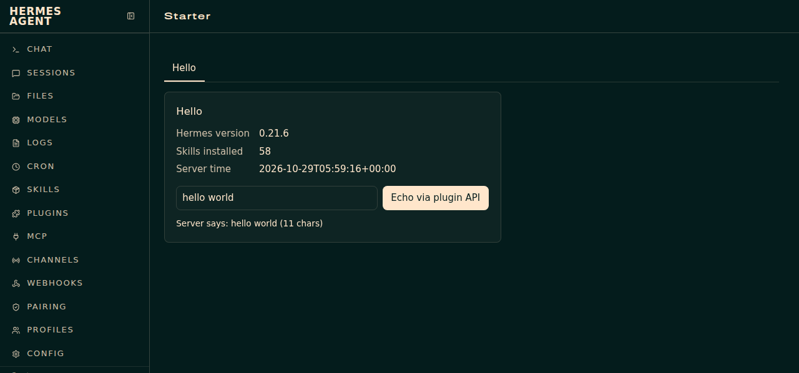

# hermes-dashboard-plugin-starter

A minimal, working example of a plugin for the [Hermes Agent](https://github.com/NousResearch/hermes-agent) web dashboard (`hermes dashboard`), built without forking Hermes.

It adds a **Starter** page to the dashboard. The page is a small core shell that loads drop-in feature modules: each module is one ES module for the UI and, if it needs one, one Python file for its backend routes. Adding a feature never touches the core files.



## Why

Hermes documents the plugin system well (manifest, `window.__HERMES_PLUGIN_SDK__`, `plugin_api.py`), but a single `index.js` and a single `plugin_api.py` grow fast once a plugin has more than one feature. Every change then edits the same two files, and one bad feature can break the whole tab.

This starter shows the layout we ended up with after running a much larger dashboard plugin in production:

- **No build step.** The core is a plain IIFE; modules are native ES modules loaded with `import()`.
- **One registry line per feature.** `dist/sp/manifest.json` lists the modules; the core renders a tab per module.
- **Backend routes auto-mounted.** `plugin_api.py` imports every `api/<name>.py` and mounts its `router` under the plugin prefix.
- **Failure isolation.** A module that fails to import, render or mount is logged and skipped. The rest of the page keeps working.
- **Theme-aware.** CSS only uses the dashboard's theme tokens (`--color-*`, `--radius`), so the plugin follows whatever theme is active. An example theme is included.

## What's inside

```
plugin/dashboard/              copy of this folder = the installed plugin
├── manifest.json              Hermes plugin manifest (name, tab, entry, css, api)
├── plugin_api.py              core FastAPI router + loader for api/*.py
├── api/
│   └── hello.py               backend of the example module
└── dist/
    ├── index.js               core shell: reads sp/manifest.json, imports modules
    ├── style.css              core styles (theme tokens only)
    └── sp/
        ├── manifest.json      module registry
        ├── hello.mjs          example module (UI)
        └── hello.css          example module styles
themes/starter.yaml            example dashboard theme
scripts/install.sh             copies the plugin (and theme) into HERMES_HOME
tests/test_plugin.py           manifest checks, loader tests, JS syntax check
```

The example **Hello** module reads the Hermes version through the SDK's built-in API client, calls its own backend (`GET /hello`, which counts installed skills), and posts a form to `POST /hello/echo`.

## Install

Requirements: a working Hermes Agent install with the web dashboard. Tested against the Hermes Agent 0.21 dashboard (plugin SDK contract 1.1.0).

```bash
git clone <this repo> && cd hermes-dashboard-plugin-starter
scripts/install.sh --theme        # plugin + example theme into ~/.hermes
```

The script copies `plugin/dashboard/` to `$HERMES_HOME/plugins/starter/dashboard/` and `themes/starter.yaml` to `$HERMES_HOME/dashboard-themes/`.

Hermes only imports a user plugin's Python backend once the plugin is in `plugins.enabled`. Add it to `~/.hermes/config.yaml`:

```yaml
plugins:
  enabled:
    - starter
```

(Depending on your Hermes version, `hermes plugins enable starter` may also work; it did not resolve dashboard-only plugins in the version we tested.)

Restart `hermes dashboard` (backend routes are mounted at startup), then open `http://127.0.0.1:9119/starter`.

Check that the backend is mounted:

```bash
# the dashboard API requires the session token printed in the page source
curl -s -H "X-Hermes-Session-Token: $TOKEN" http://127.0.0.1:9119/api/plugins/starter/health
# {"ok":true,"module_apis":{"hello":"ok"}}
```

## Configuration

| Variable | Used by | Default |
|---|---|---|
| `HERMES_HOME` | `scripts/install.sh`, `api/hello.py` (fallback when not running inside Hermes) | `~/.hermes` |
| `PLUGIN_NAME` | `scripts/install.sh` (target directory) | `starter` |

## Add a module

1. Create `plugin/dashboard/dist/sp/<id>.mjs`:

   ```js
   export function render(ctx) {
     return '<div class="todo-card"><h2>Todo</h2><ul data-list></ul></div>';
   }

   export function init(ctx, el) {
     ctx.api("/todo").then((r) => {
       el.querySelector("[data-list]").innerHTML =
         r.items.map((i) => "<li>" + ctx.esc(i) + "</li>").join("");
     });
     return () => {};            // optional cleanup on unmount
   }
   ```

   `ctx` gives you `SDK` (the dashboard SDK), `api(path, init)` (authenticated `fetchJSON` scoped to `/api/plugins/<plugin>`), `esc()` (HTML escaping) and `plugin` (the plugin name). Escape anything you put into HTML.

2. Register it in `plugin/dashboard/dist/sp/manifest.json`:

   ```json
   { "id": "todo", "label": "Todo", "module": "todo.mjs", "css": "todo.css" }
   ```

3. Optional backend, `plugin/dashboard/api/todo.py`:

   ```python
   from fastapi import APIRouter

   router = APIRouter()

   @router.get("/todo")
   async def todo():
       return {"items": ["write the README", "ship it"]}
   ```

   Prefix routes with the module id so modules cannot collide. Files starting with `_` are ignored.

4. Re-run `scripts/install.sh` and restart the dashboard (only needed for new Python routes; UI-only changes show up on reload).

## Rename the plugin

Change `"name"` (and `"label"`, `tab.path`) in `plugin/dashboard/manifest.json`, the `plugins.enabled` entry, and install with `PLUGIN_NAME=<name> scripts/install.sh`. The core reads the plugin name from its own script URL, so no JS edit is needed.

## Tests

```bash
python3 -m venv .venv && . .venv/bin/activate
pip install -r requirements-dev.txt
pytest -q
```

The tests run outside Hermes: they mount `plugin_api.py` in a bare FastAPI app, check that a deliberately broken `api/` module is skipped while the others keep serving, validate both manifests, and run `node --check` on the JS when Node is available.

## Limits

- The core renders modules as HTML strings in plain DOM, not React components. That keeps modules build-free, but you handle escaping and event wiring yourself (`ctx.esc`, the `init` cleanup).
- Modules are loaded in parallel and all at once; there is no lazy loading or per-user enable/disable.
- New Python routes need a dashboard restart. That is a Hermes behaviour, not something the starter can change.
- Backend routes run inside the dashboard process with the dashboard's permissions. Only install modules you trust, and do not expose the dashboard on a public interface.
- The Hermes plugin SDK is still evolving. If a newer Hermes changes the contract, check the official "Extending the Dashboard" documentation first.

## License

MIT, see [LICENSE](LICENSE).

## About

Built by Loic Guyon at AI Jungle — https://www.welcometotheaijungle.com
